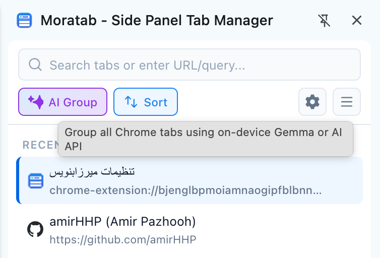
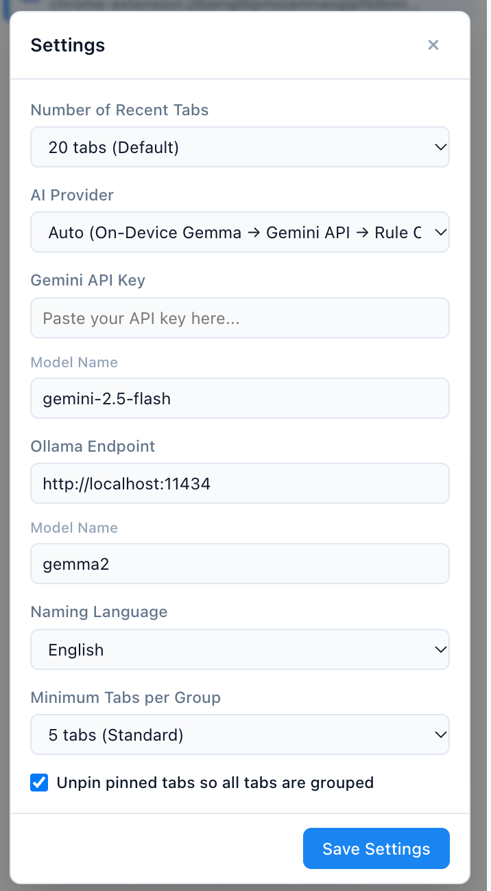

# Moratab (مرتب) — Google Chrome Side Panel Tab Manager

[](https://developer.chrome.com/docs/extensions/mv3/)
[](package.json)
[](test/e2e-runner.test.js)

**Moratab** (*مرتب*, Persian/Arabic for *"orderly / organized"*) is a Google Chrome Side Panel extension for personal tab management. Built strictly with vanilla JavaScript (ES modules), semantic HTML5, and CSS3, Moratab runs unpackaged directly in Google Chrome with zero build tooling or bundlers.

---

## Screenshots

| Side Panel Interface | Settings & AI Configuration |
| :---: | :---: |
|  |  |
| *Tab listing, multi-token search, 1-click sorting, and AI Tab Grouping.* | *Configurable recent tab limit, AI providers (Gemma, Gemini, Ollama), models, and group thresholds.* |

---

## Features

- **R1. Side Panel Interface & Tab Listing**:
  - Native Chrome Side Panel interface (opens automatically on toolbar icon click).
  - Displays all open tabs in the current window with favicon, title, and URL.
  - Clicking any tab immediately activates and focuses that browser tab.
  - Hover close button (`×`) allows closing individual tabs directly from the side panel.

- **R2. Alphabetical URL Sorting**:
  - One-click **Sort** button toggles alphabetical URL sorting for the tabs listed within the Moratab side panel.
  - **Browser Tab Safety**: Does **not** modify, move, or reorder actual open tabs in Google Chrome's tab strip.
  - **Pinned-Tab Preservation**: Pinned tabs remain safely anchored at the top; only unpinned tabs are sorted.
  - **Toggle & State Persistence**: Clicking Sort again restores the natural Chrome tab strip order; preference persists across side panel sessions.

- **R3. Dynamic Recent Tabs & Visual Separator**:
  - Displays the most recently accessed tabs above a prominent horizontal separator (default **20 tabs**, user-configurable in Settings).
  - Configurable in Settings dialog: choose from presets (5, 10, 15, 20, 25, 30, 40, 50) or specify a custom count.
  - Dynamic LRU (Least Recently Used) stack updates in real time whenever the user switches tabs (`chrome.tabs.onActivated`).
  - Automatically prunes closed tabs (`chrome.tabs.onRemoved`) and backfills recent slots from history.

- **R4. Multi-Token Search & Omnibox Fallback**:
  - Real-time search input filtering tabs simultaneously across title and URL (supports percent-decoded and Non-ASCII / Persian characters).
  - Conjunction token matching (`"guide chrome"` matches tabs with both tokens in title or URL).
  - **Omnibox Fallback on Enter**: When 0 open tabs match:
    - If the input is a valid URL, bare domain (`example.com`), `localhost:port`, or IP address, navigates directly in a new tab.
    - If the input is a search query, executes a web search in a new tab using Chrome's default search engine (with Google search fallback).

- **R5. AI-Powered Chrome Tab Bar Grouping (✨ AI Group)**:
  - **Native Chrome Tab Bar Integration**: Uses Chrome's `chrome.tabs.group` and `chrome.tabGroups.update` APIs to automatically organize open tabs into native, colored tab groups directly inside the browser's top tab strip.
  - **On-Device & Cloud AI Flexibility**:
    - **Chrome Built-in AI**: Uses Chrome's Prompt API (Gemini Nano / Gemma) running 100% locally on-device with zero config.
    - **Cloud AI (Google Gemini API)**: Connects with your free Google Gemini API key (`gemini-2.5-flash` / `gemini-1.5-flash`).
    - **Local Ollama**: Supports local LLM endpoints (e.g., `gemma2` on `http://localhost:11434`).
    - **Zero-Config Smart Heuristic Clusterer**: Automatic fallback that semantically clusters tabs by domain, keyword, and workflow, ensuring grouping ALWAYS succeeds immediately even offline or without an API key.
  - **High-Quality Naming & Bilingual Support**: Automatically names groups in fluent Persian or English depending on tab content (e.g. *"برنامه‌نویسی و کد"*, *"سرویس‌های گوگل"*, *"هوش مصنوعی و پژوهش"* or *"Development & Code"*, *"AI & Research"*).
  - **100% Tab Coverage Guarantee**: All tabs are strictly guaranteed to be assigned to a group. Pinned tabs can be automatically unpinned to ensure full grouping.
  - **Side Panel Group Badges**: Displays colored group pills directly on tabs in the Moratab side panel.
  - **AI Settings Dialog (⚙️)**: Easily customize provider, API key, model, language, and unpinning options.

---

## Project Structure

```
moratab/
├── manifest.json              # Chrome Manifest V3 declaration
├── background.js              # Service worker (openPanelOnActionClick)
├── assets/                    # Project documentation assets
│   └── screenshots/           # Extension UI screenshots
│       ├── sidepanel-view.png # Side panel interface & tab list
│       └── settings-modal.png # Settings modal & AI configuration
├── icons/                     # Extension PNG assets
│   ├── icon16.png             # 16x16 toolbar icon
│   ├── icon48.png             # 48x48 extensions management icon
│   └── icon128.png            # 128x128 Chrome Web Store icon
├── sidepanel/
│   ├── sidepanel.html         # Side panel semantic layout
│   ├── sidepanel.css          # Themeable stylesheet (dark/light mode)
│   └── sidepanel.js           # Side panel controller & Chrome event integration
├── src/
│   ├── utils.js               # Pure algorithmic core (sorting, LRU, search, classifier)
│   └── ai-grouper.js          # On-device Gemma & Gemini AI tab bar grouper & clusterer
├── test/
│   ├── ai-grouper.test.js     # Unit tests for AI prompt, reconciliation & clustering
│   ├── sidepanel.test.js      # Controller unit tests (grouping, sorting, badges)
│   ├── utils.test.js          # Unit tests (58 test cases, node:test)
│   └── e2e-runner.test.js     # Opaque-box E2E test suite (126 test cases, node:test)
├── TEST_READY.md              # E2E test suite documentation
└── README.md                  # This file
```

---

## How to Load Unpacked in Google Chrome

1. Open **Google Chrome** (version 114+ recommended for Side Panel API support).
2. In the address bar, navigate to:
   ```text
   chrome://extensions
   ```
3. In the top-right corner, toggle the **Developer mode** switch to **ON**.
4. In the top-left corner, click the **Load unpacked** button.
5. In the file picker dialog, select the Moratab root directory:
   ```text
   /Users/sotoon/personal/moratab
   ```
6. The **Moratab - Side Panel Tab Manager** extension card will now appear in your extensions list.

---

## Verification & Testing Instructions

### Manual Feature Verification in Chrome

#### 1. Verifying R1 (Side Panel & Tab Activation)
1. Click the **Moratab** action icon in the Chrome toolbar (or open via Chrome Side Panel dropdown).
2. The Moratab side panel will slide open on the right side of your browser window.
3. Verify that all open tabs in your current window are listed with their favicon, title, and URL.
4. Click on any tab in the list: observe that the browser immediately switches active focus to that tab and highlights it with an active accent border.
5. Hover over a tab and click the `×` button: verify the tab closes in the browser and disappears from the side panel.

#### 2. Verifying R2 (Alphabetical URL Sorting)
1. Open several tabs with varying URLs (e.g., `https://wikipedia.org`, `https://github.com`, `https://apple.com`, `https://bbc.com`).
2. Pin one or two tabs (e.g., pin `https://github.com`).
3. Click the **Sort** button in the Moratab header.
4. Observe:
   - Your actual Chrome browser tabs remain completely untouched in their original positions.
   - Inside the Moratab side panel, the unpinned tabs in the list are reordered alphabetically by URL (`apple.com` → `bbc.com` → `wikipedia.org`), while pinned tabs remain at the top.
   - The Sort button highlights (`.active`) to indicate that sorted view is enabled.
5. Click the **Sort** button again:
   - Observe that the side panel list toggles back to the natural tab order of the Chrome window.

#### 3. Verifying R3 (Recent Tabs Section & Separator)
1. Open at least 4 to 6 different tabs.
2. Click through 3 or 4 tabs in a specific order (e.g., Tab A, then Tab B, then Tab C).
3. Look at the Moratab side panel:
   - The top recently active tabs (default 20, or your configured count in Settings) appear in the **Recent Tabs** section above the horizontal divider line (`#sectionSeparator`).
   - The remaining tabs appear in the **Remaining Tabs** section below the divider line.
4. Switch to a tab from the remaining section: observe it dynamically promotes to the top of the **Recent Tabs** section, and the list updates smoothly.

#### 4. Verifying R4 (Tab Search & Omnibox Fallback)
1. Type a keyword into the `#searchInput` field (e.g., `wiki` or `git`).
2. Verify that matching tabs are filtered in real-time, matching words in either the title or the URL.
3. Clear the search input: all tabs reappear.
4. Type a query that matches 0 open tabs (e.g., `best macos tab manager 2026`).
5. Observe that the `#emptyState` view is displayed ("No matching tabs - Press Enter to search the web...").
6. Press **Enter**: a new tab opens performing a web search for your query using Chrome's default search engine.
7. Type a valid bare domain or URL with 0 open tabs (e.g., `news.ycombinator.com` or `https://go.dev`) and press **Enter**: a new tab opens navigating directly to that destination.

---

## Automated Test Suites

Moratab includes automated test coverage with zero external dependencies, running natively on Node.js standard libraries (`node:test` and `node:assert/strict`).

### Run All Tests
```bash
node --test test/utils.test.js && node --test test/e2e-runner.test.js
```

### 1. Pure Logic Unit Tests (`test/utils.test.js`)
Covers pinned-tab URL sorting, move planning, LRU recent tabs tracker, conjunction token search, and input classification:
```bash
node --test test/utils.test.js
```
- **Tests**: 58 passing

### 2. Opaque-Box E2E Test Suite (`test/e2e-runner.test.js`)
Covers Tiers 1–4 requirement test specifications:
- Tier 1: Feature Coverage (11 features × 5 = 55 tests)
- Tier 2: Boundary & Corner Cases (11 features × 5 = 55 tests)
- Tier 3: Cross-Feature Combinations (11 pairwise tests)
- Tier 4: Real-World Scenarios (5 comprehensive workflows)
```bash
node --test test/e2e-runner.test.js
```
- **Tests**: 126 passing

---

## Technical Specifications & Standards

- **Manifest Version**: 3
- **Permissions**: `sidePanel`, `tabs`, `favicon`, `search`, `storage`
- **UI Framework**: Vanilla JavaScript (ES2022+ modules), HTML5 semantic markup, CSS3 (Grid + Custom Properties)
- **Minimum Chrome Version**: Chrome 114+ (Side Panel API) / Chrome 121+ (Native `tab.lastAccessed`)
